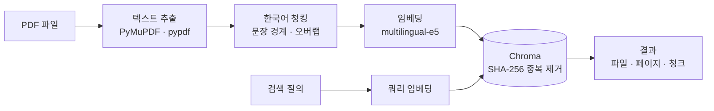
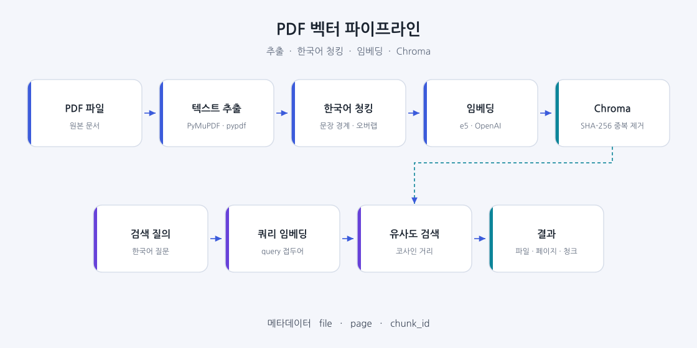
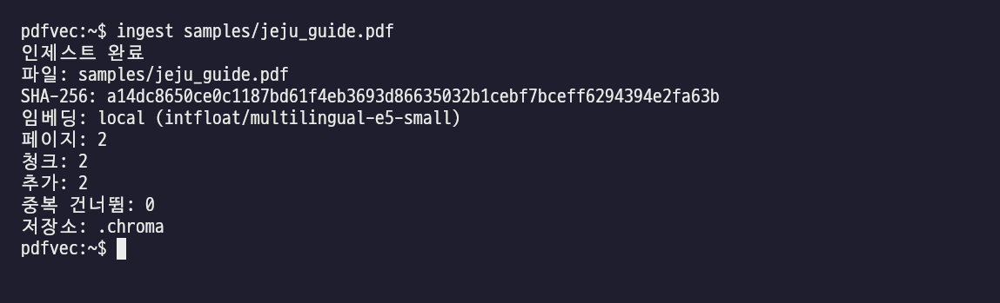
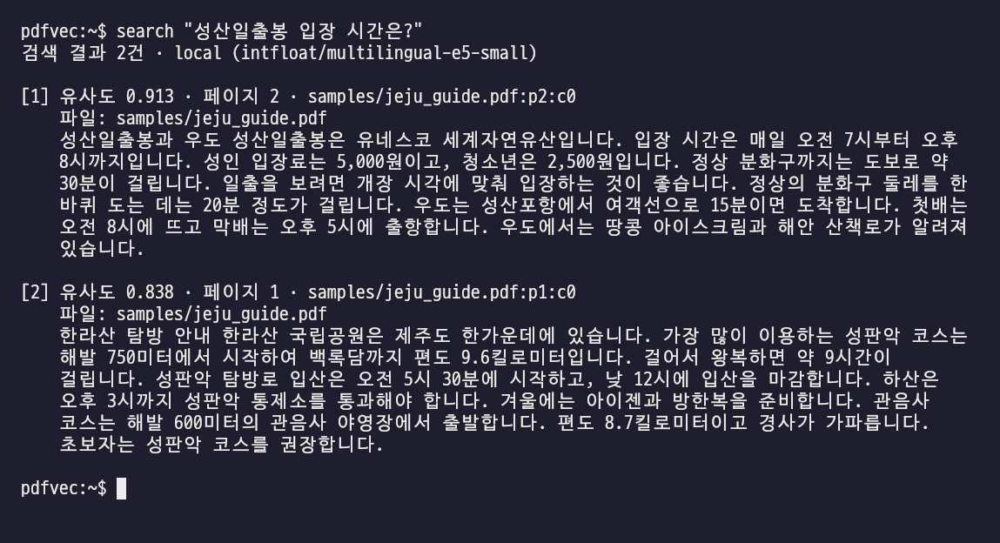

# PDF 벡터 파이프라인

PDF에서 글을 뽑아 한국어 문장 경계에 맞춰 자르고, 다국어 임베딩으로 바꾼 뒤 Chroma에 저장합니다. 저장이 끝나면 한국어 질문으로 관련 구절을 찾을 수 있습니다.

추출에는 PyMuPDF를 쓰고, 실패하거나 글자가 없으면 pypdf로 넘어갑니다. 임베딩 기본값은 로컬 모델 `intfloat/multilingual-e5-small`이고, 환경 변수로 OpenAI를 고를 수 있습니다. 같은 청크는 SHA-256으로 걸러 다시 넣지 않습니다.

[](https://github.com/kh20134/pdf-vector-pipeline/actions/workflows/ci.yml)

## 아키텍처



글자를 윤곽선으로 구운 그림은 [docs/architecture.svg](docs/architecture.svg)에 있습니다. 한글 폰트가 없는 환경에서도 같은 모양으로 보입니다.



같은 그림의 PNG 렌더(Noto Sans CJK)는 [docs/architecture.png](docs/architecture.png)입니다.

## 설치

Python 3.11 또는 3.12가 필요합니다.

```bash
python -m venv .venv
source .venv/bin/activate
pip install -e ".[local]"
```

OpenAI만 쓸 때는 `pip install -e ".[openai]"`로 충분합니다. 테스트만 돌릴 때는 `pip install -e ".[dev]"`입니다. 개발용 설치에는 임베딩 모델이 들어 있지 않습니다.

## 사용법

`ingest`와 `search`는 설치 후 바로 실행되는 명령입니다. `pdfvec` 아래 하위 명령으로도 같습니다.

```bash
ingest samples/jeju_guide.pdf
search "성산일출봉 입장 시간은?"
```

```bash
pdfvec ingest samples/jeju_guide.pdf --persist-dir .chroma
pdfvec search "한라산 성판악 입산 마감" --top-k 3
```

| 옵션 | 기본값 | 설명 |
| --- | --- | --- |
| `--persist-dir` | `.chroma` | Chroma 영구 저장 경로 |
| `--collection` | `pdfs` | 컬렉션 이름 |
| `--chunk-size` | `400` | 청크 최대 글자 수 |
| `--overlap` | `80` | 다음 청크와 겹치는 글자 수 |
| `--top-k` | `5` | 검색 결과 수 |
| `--provider` | `local` | `local` 또는 `openai` |
| `--model` | 제공자 기본 모델 | 임베딩 모델 이름 |

## 실행 예시

### 인제스트



### 검색



## 처리 과정

### 텍스트 추출

페이지마다 글을 읽습니다. 페이지 번호는 1부터입니다. PyMuPDF가 예외를 내거나 빈 문자열만 돌려주면 pypdf로 다시 읽습니다.

### 한국어 청킹

문장 끝(`습니다`, `입니다`, `합니다`, `요`, `다` 등)과 마침표를 경계로 삼습니다. 청크가 `--chunk-size`를 넘기 전에 그 경계에서 끊습니다. 다음 청크는 앞 청크의 끝을 `--overlap`만큼 겹칩니다. `9.6`처럼 소수점 뒤가 숫자이면 문장 경계로 보지 않습니다.

페이지 바깥으로 청크를 잇지 않습니다. 그래서 검색 결과에 페이지 번호를 붙일 수 있습니다. PDF가 줄바꿈으로 문장을 잘라 둔 경우는 한 줄로 이어 붙인 뒤 나눕니다.

### 임베딩

로컬 모델은 E5 계열이라 넣을 문장에는 `passage:`, 검색어에는 `query:`를 붙입니다. OpenAI를 쓸 때는 이 접두어를 붙이지 않습니다.

```bash
export PDFVEC_EMBEDDING_PROVIDER=openai
export OPENAI_API_KEY=sk-...
export OPENAI_EMBEDDING_MODEL=text-embedding-3-small   # 선택
```

로컬 모델을 바꿀 때는 `PDFVEC_LOCAL_MODEL`을 지정합니다. 제공자를 바꾸면 벡터 차원이 달라지므로 다른 `--persist-dir`이나 `--collection`을 씁니다.

### 저장과 중복 제거

Chroma 컬렉션에 코사인 공간으로 영구 저장합니다. 각 청크의 아이디는 `파일 경로 + 페이지 + 본문`의 SHA-256입니다.

메타데이터는 다음 필드를 가집니다.

| 필드 | 내용 |
| --- | --- |
| `file` | 작업 디렉터리 기준 상대 경로 |
| `page` | 1부터 시작하는 페이지 번호 |
| `chunk_id` | `{file}:p{page}:c{번호}` |

같은 파일 바이트의 SHA-256이 이미 있으면 임베딩을 다시 계산하지 않고 건너뜁니다. 파일이 바뀌면 그 파일의 청크를 지우고 다시 넣습니다. 청크 아이디가 이미 있으면 그 청크는 추가하지 않습니다.

## 샘플

`samples/jeju_guide.pdf`는 한라산과 성산일출봉 안내를 담은 두 쪽짜리 한글 PDF입니다. 글꼴이 파일 안에 들어 있습니다. 다시 만들 때는 나눔고딕이 설치된 곳에서 `python scripts/build_sample_pdf.py`를 실행합니다.

## 테스트

CI는 임베딩 모델을 받지 않습니다. 테스트가 결정적 해시 임베더를 넣습니다.

```bash
pip install -e ".[dev]"
pytest
```

GitHub Actions가 Python 3.11과 3.12에서 같은 테스트를 실행합니다.

## 디렉터리

```
src/pdfvec/    추출, 청킹, 임베딩, Chroma, CLI
tests/         pytest
samples/       한글 샘플 PDF
docs/          구조도와 터미널 화면
.github/       CI
```

## 라이선스

MIT
